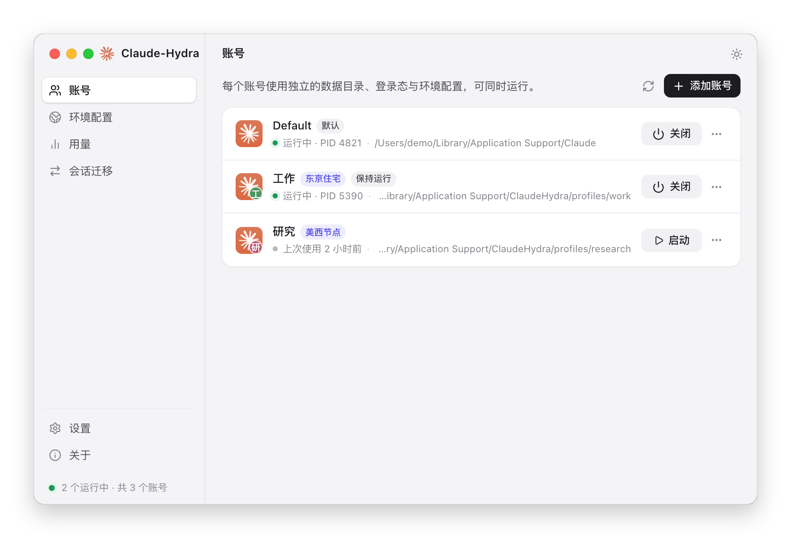
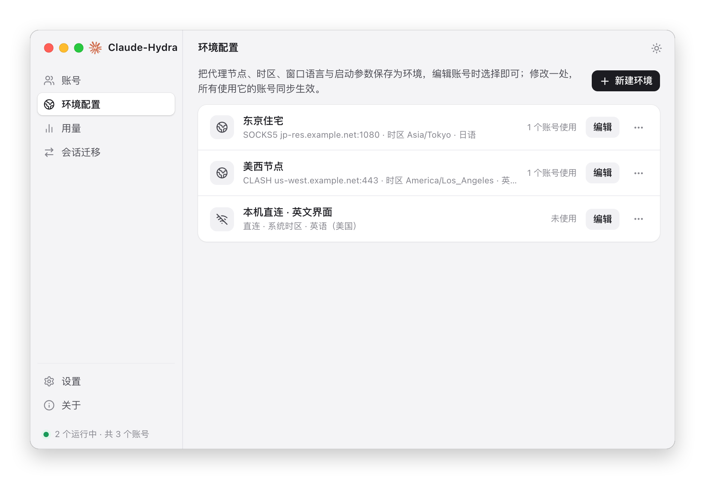
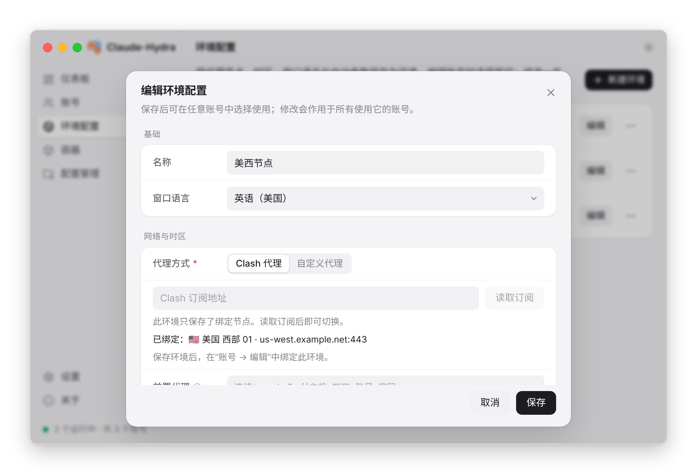
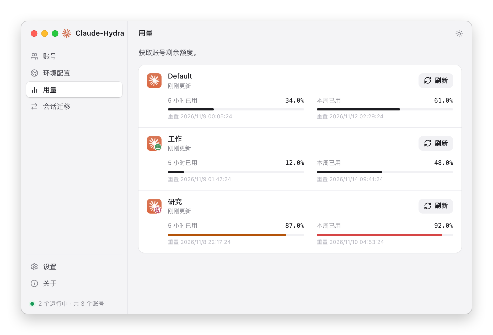

<div align="center">


# Claude-Hydra

**同时运行多个 Claude 桌面端账号，每个账号配置防泄漏策略，拥有独立的数据目录、代理节点与时区。**

基于 Tauri 2（Rust + React）构建，支持 Windows 与 macOS。


<picture>
  <source media="(prefers-color-scheme: dark)" srcset="docs/images/accounts-dark.png">
  
</picture>

</div>

## 目录

- [功能概览](#功能概览)
- [快速开始](#快速开始)
- [环境配置](#环境配置)
- [防泄漏机制](#防泄漏机制)
- [避免直连的使用建议](#避免直连的使用建议)
- [时区同步](#时区同步)
- [仪表板与用量统计](#仪表板与用量统计)
- [配置管理](#配置管理)
- [Claude Code 容器（macOS + OrbStack）](#claude-code-容器macos--orbstack)
- [平台差异](#平台差异)
- [数据存储与安全](#数据存储与安全)
- [已知限制](#已知限制)

## 功能概览

| 功能 | 说明 |
| --- | --- |
| 多账号并行 | 通过 `--user-data-dir` 为每个账号提供独立的配置与登录态，可同时打开多个 Claude 窗口 |
| 环境配置 | 把代理节点、时区、窗口语言、启动参数与环境变量保存为“环境”，多个账号共用，修改一处同步生效 |
| 代理节点 | 支持 Clash 订阅节点（内置 Mihomo 内核，无需另装）与自定义 SOCKS5 / HTTP / HTTPS 节点，附出口检测与换 IP 链接 |
| 防泄漏 | 内置本机中继，DNS、WebRTC、UDP/QUIC、IPv6 全部经节点或被阻止；节点失效时断网而非直连 |
| 时区同步 | 时区可跟随代理出口、跟随系统或手动指定；确认出口后直接显示具体时区 |
| 仪表板 | 启动首页：容器账号的 token 消耗、API 等价成本、活动热力图与趋势，以及各账号订阅的 5 小时与每周额度 |
| 配置管理 | 浏览、阅读、迁移和导出本机、桌面版账号与容器的 Claude Code 会话；管理 CLAUDE.md、settings.json、技能、命令、MCP 与插件 |
| Claude Code 容器 | macOS 上借助用户自装的 OrbStack，在容器中运行 Claude Code；网络只经环境的代理节点，UDP / IPv6 / 直连全部阻断 |

## 快速开始

1. 打开 **Claude-Hydra**，在左侧 **环境配置** 中点击 **新建环境**，选择代理方式并点 **连通检测** 确认出口（不需要代理可跳过）。
2. 回到 **账号** 页，点击右上角 **+ 添加账号**，填写窗口名称并选择环境，点击 **确定**。
3. 在弹出的全新 Claude 窗口中登录，即可与其他账号同时在线。
4. 点击账号卡片上的 **启动** 打开账号，运行中时可点 **关闭**；双击卡片可启动账号或切到它的窗口。右侧 **···** 菜单可编辑、重启或打开数据目录。

## 环境配置

<div align="center">

</div>

环境保存后可在任意账号中选择使用，修改会作用于所有使用它的账号。列表中显示代理节点、已确认的出口时区与窗口语言。

<div align="center">

</div>

| 字段 | 说明 |
| --- | --- |
| 窗口语言 | 以 `--lang` 启动 Claude，如英语（美国）、日语 |
| 代理方式 | **Clash 代理**：填写订阅地址并点 **读取订阅**，从列表中选择节点；由内置的 Mihomo 内核运行，支持 Clash 的各类协议<br>**自定义代理**：SOCKS5 / HTTP / HTTPS，可选 IPv4 / IPv6 出口 |
| 代理主机 / 端口 | 自定义代理时使用；主机栏可粘贴 `socks5://主机:端口:账号:密码`、`账号:密码@主机:端口`、`主机:端口:账号:密码`，自动拆分 |
| 账号密码 | 选填，最多 200 个字符；只保存在本机，不会出现在 Claude 的启动参数或环境变量中 |
| 出口检测 | 检测出口所用的服务：ipinfo.io / ipapi.co / ip-api.com。**连通检测** 经节点查询出口 IP、地区、时区、家宽 / 机房判断与风险记录，结果随环境保存 |
| 刷新 URL | 服务商提供的换 IP 链接，点击右侧按钮直接请求（不经过节点） |
| 时区 | 见 [时区同步](#时区同步) |
| 额外启动参数 / 环境变量 | 高级选项；代理相关参数与变量由 Hydra 管理，不能手动覆盖 |

保存后，新建的连接立即使用新节点；时区、窗口语言与启动参数在重启该账号后生效。

## 防泄漏机制

配置了节点的账号，网络路径为：

```text
Claude 窗口 / 子进程 ──► 127.0.0.1 本机中继（Hydra 后台）──► 代理节点 ──► 互联网
                                        └─ Clash 节点经内置 Mihomo 内核转换
```

Claude 只看得到本机中继地址；节点的账号密码保存在 Hydra 内部，不会出现在 Claude 的启动参数或环境变量中。

| 泄漏途径 | 处理方式 |
| --- | --- |
| DNS | 通过 SOCKS5 代理（`--proxy-server=socks5://…`）把域名原样交给节点解析；Claude 自身已关闭 DNS 预解析 |
| WebRTC | `--force-webrtc-ip-handling-policy=disable_non_proxied_udp`，不暴露本机或 STUN 地址 |
| UDP / QUIC | `--disable-quic`；中继拒绝 SOCKS5 UDP ASSOCIATE |
| IPv6 | Claude 只连接 127.0.0.1 中继，不直接使用本机 IPv6 |
| 子进程 | Claude Code、MCP 等通过 `HTTP(S)_PROXY`、`ALL_PROXY`、`NODE_USE_ENV_PROXY` 指向同一中继 |
| 节点失效 | 每次启动前经“中继 → 节点”检测出口，失败不启动；运行中节点断开或 Hydra 退出，该账号断网，不回退直连 |

上述开关已用无头 Chrome 实测：WebRTC 候选地址由 3 个降为 0；中继关闭时页面无法加载。

> Claude 会拒绝带 `--host-resolver-rules` 等网络覆盖开关的启动，因此 Hydra 不使用这类开关，也会在保存环境时拦截它们。

> 账号运行期间请保持 Claude-Hydra 在托盘中运行。

## 避免直连的使用建议

代理节点只在通过 Claude-Hydra 启动账号时生效（主界面、托盘）。直接打开 Claude 时，它会进入**默认账号**，不经过任何节点。Hydra 创建的额外账号无法被直接打开，因此按以下方式使用即可避免账号直连：

1. **默认账号保持未登录。** 如果默认账号曾经登录过，请先在 Claude 中退出登录。之后无论是直接打开 Claude，还是 Claude 自动更新后自行重启，看到的都只是一个未登录的空白窗口，不会带着你的账号用真实 IP 联网。
2. **所有需要代理的账号都在 Hydra 中创建并登录。** 默认账号不建议配置代理节点。
3. **登录时让系统网络也走同一节点。** Google 等方式的登录页在系统认证窗口或浏览器中打开，走的是系统网络而不是 Hydra 的节点。登录前请让系统代理（例如 Clash）临时切换到与该账号相同的节点，登录完成后再恢复。
4. **账号运行期间不要退出 Claude-Hydra。** 退出后已配置节点的账号会断网，不会回退直连，重新打开 Hydra 即可恢复。
5. **留意自行联网的工具。** 不读取代理环境变量、自行直连网络的 MCP 服务或命令行工具可能绕过节点，请优先选用支持 `HTTPS_PROXY` 的工具。

> macOS 上点击 Dock 中的 Claude 时，若已有 Hydra 账号在运行，系统通常会切换到该窗口而非新开默认账号；需要打开默认账号时请从 Hydra 启动。

## 时区同步

| 选项 | 行为 |
| --- | --- |
| 跟随代理 IP（默认） | 每次启动时经节点查询出口时区并应用；查询不到则不启动。确认过出口后，选项与环境列表直接显示具体时区，如 `America/Los_Angeles` |
| 跟随系统 | 不修改时区 |
| 自定义 | 使用指定的 IANA 时区，如 `Asia/Tokyo` |

时区通过 `TZ` 环境变量传给 Claude。macOS 上 Claude 窗口与子进程均生效；Windows 上 Claude 窗口可能仍显示系统时区，仅子进程确定生效。

## 仪表板与用量统计

<div align="center">

</div>

在 **仪表板** 的「桌面账号额度」中点击账号右侧的 **刷新**，读取 Claude 返回的 5 小时、每周以及按模型的周额度（包含同账号在其他设备上的用量）。同一账号 60 秒内不重复请求；配置了节点的账号经节点查询。

**剩余额度趋势**：展开账号下方的「剩余额度趋势」，可按额度窗口查看当前周期的剩余走势（虚线为匀速用完的参考线）与最近 14 天的每日额度用量。每次成功读取都按 token-monitor 的方式记录：同一周期内连续不变的读数合并为一段，两次读数间已用百分比的增长只有在同一天内才计入当天，跨日期的部分单列为“未分配”，重置不算消耗；记录保留 35 天，存放在 `quota-history/`。手动刷新过一次的账号，Hydra 运行期间每 10 分钟在后台再读一次（经该账号自己的中继或节点，被出口保护切断的账号跳过），可在 **设置 → 用量** 中关闭；macOS 上的桌面账号读取凭据需要钥匙串授权，只在手动刷新时记录。

- Windows：使用当前 Windows 用户解密本机登录凭据。
- macOS：首次读取时系统会询问是否允许访问钥匙串中的“Claude Safe Storage”，请选择“允许”。
- 用量凭据由 Claude 桌面端在使用 Claude Code 等功能时生成。只登录、从未使用过这些功能（或因身份验证等原因无法使用）的账号暂时无法读取用量，页面会给出说明。

**容器账号（macOS）**：仪表板顶部的「总览」汇总所有容器的总 token、API 等价成本、活跃天数、最长连续、活跃时间、峰值单日、常用模型与模型响应数，并给出一年的活动热力图和按模型、按容器的占比；「趋势」按容器查看每日 token 或成本折线（7 / 30 / 90 天）。

- 数据读取自各容器的 Claude 数据文件夹中的会话记录，不联网、不进入容器。每次读取后按小时、按模型汇总存入 `containers/<容器账号ID>/usage-history.json`：重新读取时同一小时同一模型取 token 更多的一份，Claude Code 清理旧会话记录（默认 30 天）后已记录的消耗仍然保留；从未被 Hydra 读取过的旧记录无法补回。
- 成本按 Anthropic 官方 API 单价估算（含缓存读写与快速模式），是“若按 API 计费”的等价金额，不是订阅实际扣费；没有已知单价的模型单独标为未定价。
- 额度点击「额度」时经该账号自己的中继与节点查询；Hydra 只读取容器中 Claude Code 保存的凭据，不会刷新它，凭据过期时在容器中运行一次 `claude` 即可。

此接口未公开，可能随 Claude 更新而变化。

## 配置管理

左侧 **配置管理** 页以 Claude Code 的数据目录为单位管理会话和配置，不用再去 Finder 里翻文件夹。页面先列出所有位置，按**本机**（`~/.claude`，Windows 为 `%USERPROFILE%\.claude`）、**桌面版账号**（有独立 Claude Code 目录时用它自己的，否则与本机共用）、**容器账号**（容器设置里的 Claude 数据文件夹）分组，显示会话数和最近活动，位置多时可搜索。选中后列表收起到顶部，旁边有 **在 Finder 中显示**（Windows 为资源管理器）和 **切换位置** 按钮。容器账号只在 macOS 上有，其余功能 Windows 同样可用。登录凭据不会被显示、复制或导出。

**会话**：按工作目录分组列出标题、最后活动时间、模型、轮数和大小，可搜索；点标题阅读完整对话（思考、工具调用和结果默认折叠）。勾选后可以：

1. **复制到 / 移动到**其他位置。Claude Code 只在会话原来的工作目录下列出它（`claude --resume`），所以迁移时每个工作目录都要对应到目标那一侧：Hydra 按容器共享的文件夹自动换算（例如 Mac 上的 `/Users/me/code/app` ↔ 容器里的 `/workspace/app`），换算不了的由你指定。只改写记录里的工作目录，对话内容原样保留；目标里已有的会话跳过，不覆盖。移动会把原会话放进来源位置的回收站。
2. **导出**为 zip，在另一台电脑或另一个位置 **导入**，导入时同样换算工作目录。
3. **删除**到回收站，可在 **回收站** 标签页恢复。30 秒内还在写入的会话不能删除或移动，以免和正在运行的 Claude Code 冲突。

**记忆与设置**：编辑 `CLAUDE.md` 与 `settings.json`；文件在别处被改过时拒绝覆盖，`settings.json` 保存前检查 JSON 格式。

**技能与命令**：列出 `skills`、`agents`、`commands`，可查看、编辑、删除，或复制到其他位置（同名时默认保留目标的版本）。

**MCP 与插件**：列出 `.claude.json` 中的 MCP 服务器（环境变量与请求头的值隐藏），可删除，或把全局的复制到其他位置；插件可启用或停用，安装和卸载仍在 Claude Code 里用 `/plugin` 完成。修改前最好先退出该位置正在运行的 Claude Code。

**桌面版会话**（仅桌面版账号）：Claude.app 侧边栏里的会话列表。

1. 可在账号之间迁移会话；目标账号正在运行时，Hydra 会提示需要重启，确认后自动关闭、复制并重新启动它（桌面端只在启动时读取会话列表）。
2. 目标账号必须已至少有一个 Claude Code 会话，且只登录了一个身份。
3. 只复制会话索引（`claude-code-sessions` 下的 `local_*.json`），原文件保留，同名会话跳过不覆盖。
4. **普通聊天续聊**：在来源账号中通过“设置 → 隐私 → 导出数据”导出，点击 **导入聊天JSON** 选择解压后的 `conversations.json`，将聊天保存到目标账号的会话列表，打开后可作为附件在新聊天中继续对话。

设计细节见 [docs/claude-config-management.md](docs/claude-config-management.md)。

## Claude Code 容器（macOS + OrbStack）

在左侧 **容器** 页新建容器账号：选择一个**带代理节点**的环境，添加要共享的项目文件夹，点 **打开** 即在终端中进入容器，输入 `claude` 开始使用。Hydra 不内置容器运行时，使用你自己安装的 [OrbStack](https://orbstack.dev)（`docker --context orbstack`）；docker 路径与打开容器用的终端（Terminal.app / iTerm2 / Ghostty）在 **设置 → OrbStack 容器** 中配置。

每个容器账号有自己的一套：

```text
工作容器 claude-hydra-<id>（无网络权限，no-new-privileges）
   └─ 共享网关的网络空间
网关 claude-hydra-<id>-gw ──TCP（HTTP CONNECT）/ DNS（DoH）──► Mac 上该账号的本机中继 ──► 代理节点
Mac 文件夹 → /root/.claude（Claude Code 的登录、设置与 .claude.json，CLAUDE_CONFIG_DIR）
数据卷 claude-hydra-<id>-home → /root 的其余部分（shell 历史等）
```

| 项目 | 行为 |
| --- | --- |
| 网络 | 网关默认拒绝一切出站，只允许连接本账号中继；DNS 经节点走 DoH，失败返回 SERVFAIL；UDP、QUIC、ICMP、IPv6 被阻断。出口保护切断中继或 Hydra 退出时，容器断网，不回退直连 |
| 打开前检查 | 经中继检测出口并校验出口规则；首次使用时构建内置镜像（终端中可见进度）；核对工作容器与网关处于同一网络空间 |
| 时区 / 语言 | 每次打开终端时按环境设置 `TZ`、`LANG`：跟随代理时取出口时区，跟随系统时取 Mac 的时区；环境中的其他环境变量一并传入（代理变量除外） |
| 共享文件夹 | 挂载到 `/workspace/<名称>`；不能共享 `/`、用户主目录或包含 Hydra 数据的目录 |
| 镜像 | 内置镜像：Debian 12、Node 22、Claude Code、Python、编译工具链；也可填写 OrbStack 中已有的镜像 |
| Claude 数据 | 默认保存在 Hydra 数据目录的 `containers/<id>/claude`（仅本人可读，含明文登录凭据）；也可选择其他 Mac 文件夹，例如已有的 `.claude` 目录。不能使用 Mac 自己的 `~/.claude`，每个容器账号各用一个文件夹 |
| SSH | 可选转发 Mac 的 SSH agent（私钥不进入容器） |
| 网络审计 | 容器内自带 `hydra-audit`（只读挂载，容器内无法改动）。默认不运行，进入容器时会提示：`hydra-audit` 检查出口、IPv6 / UDP / 原始套接字、宿主机服务与云元数据，并短时采样后打分；以经本账号中继看到的节点出口为准，任何不经节点的出口（不论国家）或已知真实 IP 都判为严重并给出警告。`hydra-audit watch` 持续监测，`--background` 后台运行，`status` / `stop` 查看或停止 |
| 重建 | 修改共享文件夹、Claude 数据文件夹或 SSH 设置后需要重建；可选择先保存快照以保留容器内安装的软件，Claude 数据与 `/root` 数据卷始终保留 |

也可以在任意终端执行 `claude-hydra --container <名称>` 进入，或在容器菜单中创建桌面快捷方式。

> Claude Code 登录时显示的链接在 Mac 的浏览器中打开，走的是系统网络；登录前请让系统代理切到与该账号相同的节点。

## 平台差异

| 功能 | Windows | macOS |
| --- | --- | --- |
| 多账号 | ✅ | ✅ |
| 环境配置、代理节点与防泄漏中继 | ✅（商店版默认账号除外） | ✅ |
| 时区同步 | ⚠️ 子进程生效，窗口待实测 | ✅ |
| 用量统计（桌面账号额度） | ✅ | ✅ |
| 会话迁移 / 聊天续聊 | ✅ | ✅ |
| Claude Code 容器 | — | ✅（需自行安装 OrbStack） |

## 数据存储与安全

| 平台 | 根目录 |
| --- | --- |
| Windows | 存在 D 盘时为 `D:\ClaudeHydra`，否则为 `%LOCALAPPDATA%\ClaudeHydra`；可用环境变量 `CLAUDE_HYDRA_ROOT` 自定义 |
| macOS | `~/Library/Application Support/ClaudeHydra` |

- `settings.json`：账号与环境配置。节点密码在 Windows 上以 DPAPI 加密保存；macOS 上设置文件权限为仅本人可读。
- `profiles/<账号ID>`：额外账号的 Claude 数据目录。
- `mihomo-run/`：Clash 节点运行时的临时目录，内核退出后自动清理。
- `containers/<容器账号ID>`：网关读取的中继地址、终端入口脚本、用量历史 `usage-history.json`，以及默认的 Claude Code 数据文件夹 `claude/`；容器、网关、数据卷与快照保存在 OrbStack 中。删除容器账号时一并删除（自选的 Claude 数据文件夹除外）。
- 默认账号继续使用 Claude 原有的数据目录。

## 已知限制

- 防泄漏覆盖 Claude 的 Chromium 网络栈与读取代理环境变量的子进程；不读取代理变量、自行直连的子进程，以及在系统认证窗口或浏览器中打开的登录页无法拦截。需要系统级保证时，请配合防火墙或独立虚拟机。
- 独立数据目录只隔离本地登录数据，不修改设备指纹，也不保证账号之间不被关联。
- 使用代理节点时，额外启动参数中不能再包含 `--proxy-server` 等代理开关。
- Claude 会拒绝带调试或网络覆盖开关（如 `--remote-debugging-port`、`--host-resolver-rules`、`--ignore-certificate-errors`）的启动，Hydra 保存环境时会提示移除。
- macOS 版未经 Apple 签名公证；从浏览器下载后首次打开如提示“已损坏”，请运行 `xattr -cr /Applications/Claude-Hydra.app`。之后的版本通过应用内更新安装。
- 商店版（MSIX）的默认账号由系统启动，无法应用代理节点、时区与额外参数。
- 用量统计与会话迁移依赖 Claude 桌面端未公开的数据格式，可能随其更新失效。

## 许可证

本项目基于 [MIT License](LICENSE) 开源。


## 社区

- **[linux.do](https://linux.do)** - 学AI，上L站.