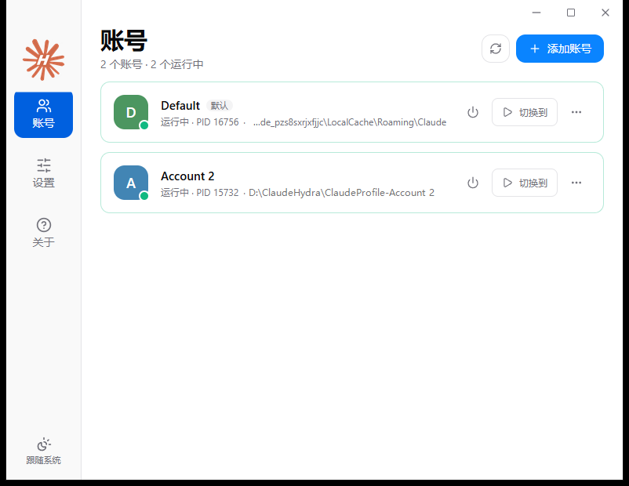

<div align="center">


# Claude-Hydra

**基于 Tauri 2（Rust + React）构建的 Claude 桌面端多账号管理工具。**<br>
为每个账号提供独立的数据目录与登录态，支持多账号同时在线运行与一键切换。


</div>

## 功能特性

- **多账号并行隔离**：通过 `--user-data-dir` 为每个账号提供独立的配置目录与 Cookie，工作与个人账号互不干扰，支持同时打开多个 Claude 桌面端实例。
- **轻量系统托盘**：关闭主窗口后自动销毁 WebView，仅保留极小的 Rust 后台进程驻留系统托盘，实时感知各账号运行状态。
- **进程树完整回收**：关闭指定账号时自动终止其主进程及关联子进程（含渲染进程与会话创建的 MCP 服务进程）。
- **异常退出守护（保持运行）**：开启后当 Claude 因自动更新或系统注销退出时自动重新拉起，用户主动退出则不打扰。
- **桌面快捷方式直达**：一键为指定账号生成原生桌面快捷方式，通过 `--launch` 毫秒级启动或唤醒对应窗口。
- **个性化配置**：支持自定义账号名称、头像配色、独立环境变量（如代理配置）与额外启动参数，并提供浅色/深色/跟随系统主题。

## 界面预览



## 快速使用

1. 打开 **Claude-Hydra**，点击右上角或托盘菜单中的 **+ 添加账号**。
2. 在弹出的全新 Claude 窗口中完成登录，即可与默认账号同时在线运行。
3. 点击账号卡片上的 **启动 / 切换到**（或双击卡片）即可启动或置顶对应窗口；点击右侧菜单可编辑名称、配色、环境变量、创建桌面快捷方式或打开数据目录。

### 默认数据存储位置

- **Windows**：若存在 D 盘则默认使用 `D:\ClaudeHydra`，否则使用 `%LOCALAPPDATA%\ClaudeHydra`（可通过环境变量 `CLAUDE_HYDRA_ROOT` 自定义）
  - 配置文件：`settings.json`
  - 额外账号目录：`profiles\<账号ID>`
- **macOS**：`~/Library/Application Support/ClaudeHydra`

## 命令行参数

```text
claude-hydra                   打开主窗口
claude-hydra --tray            仅启动到系统托盘
claude-hydra --launch <账号>   启动指定账号；若已在运行则将其窗口置顶
claude-hydra --close <账号>    关闭指定账号的 Claude 进程树
claude-hydra --restart <账号>  重启指定账号的 Claude
claude-hydra --add-account     创建新账号并打开登录窗口
claude-hydra --list            列出所有账号及运行状态
claude-hydra --watch           执行一次“保持运行”检查
claude-hydra --version         打印版本号
```

## 开发与构建

环境要求：Node.js 22+、pnpm 11+、Rust 1.95（见 `app/rust-toolchain.toml`）及对应平台的 Tauri 2 构建依赖。

在 `app/` 目录下执行：

```bash
pnpm install --frozen-lockfile
pnpm tauri dev          # 启动开发调试
pnpm tauri build        # 构建安装包 (NSIS)
pnpm typecheck          # TypeScript 类型检查
pnpm build:renderer     # 构建前端资源
pnpm test:rust          # 运行 Rust 单元测试
```

## 许可证

本项目基于 [MIT License](LICENSE) 开源。
